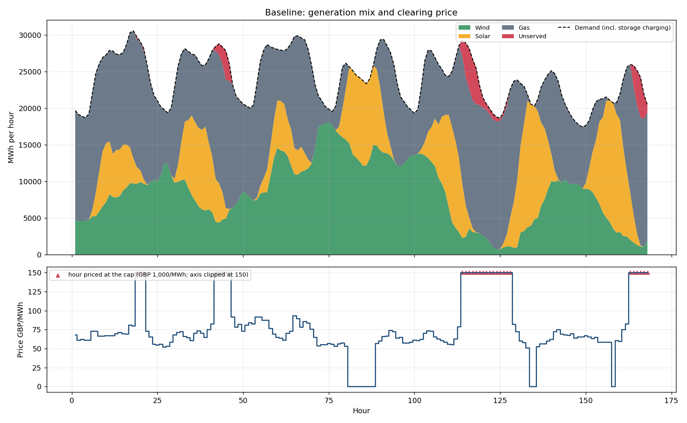
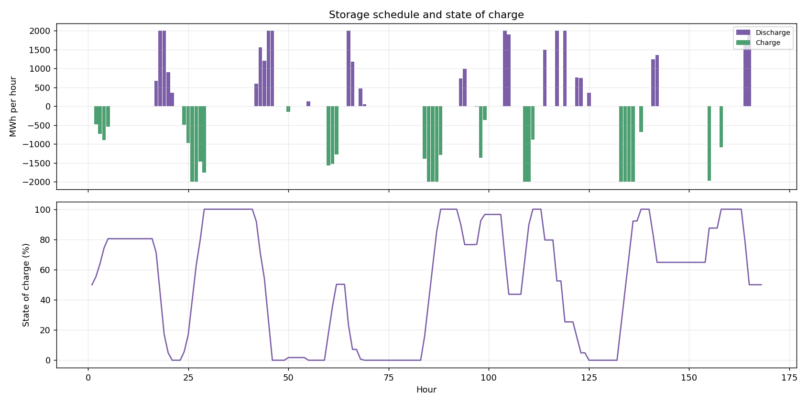

# Electricity auction and storage model

Python simulation of an hourly pay-as-clear electricity auction for the 168 hours in `data/data.xlsx`
(6 wind, 10 solar and 5 gas plants) plus a storage extension.

## Run it

```bash
pip install -r requirements.txt
python run_model.py            # writes everything to outputs/
pytest                         # 16 tests
```

Options: `--price-cap`, `--storage-power`, `--storage-energy`, `--round-trip-eff` (see `python run_model.py -h`).

| Path | Purpose |
|---|---|
| `dispatch/data.py` | Load and validate the workbook; gas bid conversion |
| `dispatch/auction.py` | Merit-order, pay-as-clear clearing (`clear_hour`, `run_auction`) |
| `dispatch/storage.py` | Storage optimisation and its participation in the auction |
| `dispatch/report.py` | Summary tables and charts |
| `tests/` | Unit and consistency tests |
| `outputs/` | `baseline_hourly_results.csv` (price + dispatch of every plant, every hour), `baseline_technology_mix_pct.csv`, `storage_*` equivalents, `summary.csv`, sensitivities, charts |

## 1. The auction

* **Bids.** Wind and solar bid £0/MWh. Gas bids its fuel cost per MWh of *electricity*:
  `price (p/therm) / 100 * 34.121 / efficiency`  (e.g. hour 1, gas1: 70p, 35% efficient = £68.24/MWh).
* **Offer sizes.** Wind and solar: `load factor x capacity` for the hour. Gas: full capacity.
* **Clearing.** Offers are sorted by bid. Each price level is dispatched until demand is met. The bid of the
  last unit needed (the lowest bid at which dispatching everything at or below it fills demand) is the price paid to
  every dispatched MWh. Offers with identical bids are scaled back pro rata at the margin.
* **Technology mix** per hour: `outputs/*_hourly_results.csv` (MWh) and `*_technology_mix_pct.csv` (share of supply).

### Two features of the data the model has to handle

1. **Surplus hours (11).** Wind and solar alone exceed demand (hours 81-88, 134, 135, 158). The price is £0 (the
   marginal bid) and the excess is curtailed pro rata. Negative prices are not modelled because there are no
   subsidies or must-run costs in the brief.
2. **Shortfall hours (29).** Total available supply is below demand (hours 19-21, 42-46, 114-128, 163-168), so no bid
   can fill demand and the marginal-price rule has no answer. I report the missing energy as **unserved energy** and
   set the price to a **scarcity price cap, £1,000/MWh** (assumption; there are no demand-side bids to set a price). It is
   a parameter (`--price-cap`) and every result involving it is also shown at £300 and £4,000.

### Baseline results

| | |
|---|---|
| Wind / solar / gas supplied | 1,421 GWh (35.6%) / 785 GWh (19.7%) / 1,783 GWh (44.7%) |
| Unserved energy | 60.3 GWh (1.5% of demand) in 29 hours |
| Price in the other 139 hours | £0 - £93.6/MWh, median £65.2 |
| Hours by marginal unit | gas4 33, gas2 32, gas3 30, gas1 17, gas5 16, renewables (£0) 11, scarcity 29 |



## 2. Storage

### How storage participates (decision)

Storage is a **competitive participant with perfect foresight** of demand, gas prices and load factors (the brief says
these are known ahead). It is a price taker in intent: it neither withholds capacity nor tries to move prices.

1. **Plan.** One linear programme over the whole horizon minimises system cost (gas fuel + scarcity cost of unserved
   energy + a small throughput cost) subject to hourly balance and storage physics. In a convex market like this the
   cost-minimising schedule is also the profit-maximising schedule of a price-taking storage owner.
2. **Bid.** The LP also gives the value of stored energy in each hour. Storage **offers its discharge** into the
   auction at its opportunity cost (throughput cost + stored-energy value / discharge efficiency), so it is
   dispatched only when the price covers that cost, and it sets the price when it is the marginal unit. Its
   **charging** is extra demand in the hours the plan charges.
3. **Clear.** The same merit-order auction as the baseline is re-run, so prices, dispatch and profits all come
   from the auction, not from the LP. Storage is paid (and pays) the cleared price.

Why not a simple rule (charge when cheap, discharge when dear)? The data has long shortfalls (e.g. 15 hours in a row
from hour 114), so the value of stored energy depends on what happens many hours later; a fixed price threshold
could spend the store before it is needed.

### Assumptions (illustrative, not a real asset)

2,000 MW charge and discharge power, 8,000 MWh usable energy (4 hours), 85% round-trip efficiency (about 92.2% each
way), starts and ends at 50% charge (so there is no free energy), £1/MWh throughput cost, no degradation,
ramping or outage limits, one hour resolution.

### Results (2,000 MW / 8,000 MWh)

| | No storage | With storage |
|---|---|---|
| Hours with unserved energy | 29 | 21 |
| Unserved energy | 60.3 GWh | 41.2 GWh |
| Hours priced at the £1,000 cap | 29 | 26 |
| Mean price, excluding cap hours | £62.09 | £63.23 |
| Curtailed renewables | 36.0 GWh | 26.0 GWh |
| Gas generation | 1,783 GWh | 1,799 GWh |
| Cost of served demand (price x served MWh) | £862m | £803m |
| Storage charge / discharge | - | 42.9 GWh (avg £45/MWh) / 36.4 GWh (avg £544/MWh) |
| Storage profit (after throughput cost) | - | £17.8m |



What this shows:

* Storage charges in cheap and surplus hours (absorbing curtailed wind and solar at £0) and discharges at the
  evening peaks and into the shortfalls. Because it fills some shortfall hours entirely, **five hours that were
  unserved are now served but still priced at about £1,000**: storage is then the marginal unit and offers at the
  value of the energy it could have used in a shortfall.
* The mean price outside the cap-priced hours is about £1 higher with storage (it adds demand in cheap hours). Gas
  burn rises slightly, because round-trip losses (15%) must be replaced.
* **All of the profit comes from the cap-priced hours**: £18.4m earned there against -£0.6m in all other hours
  (energy bought in ordinary hours is mostly sold in the cap hours), £17.8m net. The result therefore depends
  directly on the scarcity price assumption (`outputs/sensitivity_price_cap.csv`: £4.9m at a £300 cap, £17.8m at
  £1,000, £73.1m at £4,000). The brief does not say how scarcity is priced.
* Size matters (`outputs/sensitivity_storage_size.csv`): 8,000 MW / 4 h removes almost all unserved energy (60.3 to
  4.6 GWh) and earns £43.4m, but profit per MW falls as the fleet grows (about £8.9k/MW at 2,000 MW vs £5.4k/MW at 8,000 MW)
  because storage reduces the scarcity it earns from.

### Checks (`outputs/storage_consistency_checks.csv`, `tests/`)

The auction delivers exactly the planned discharge; state of charge stays within 0-8,000 MWh and ends at its start;
energy out = 85% of energy in; storage never charges and discharges in the same hour; storage never pays above its
value to charge; zero-size storage reproduces the baseline prices. In 14 charging hours the auction price is a
little below the LP price: storage is at a step between two gas bids, where the price is indeterminate, and the
auction's "lowest bid that fills demand" rule applies.

## 3. Other tests

Hand-worked clearing cases (partial margin, exact fill, pro-rata curtailment, shortfall, tied bids), an independent
naive re-implementation compared on 500 random markets, hourly energy balance and capacity limits on the real data.

## 4. Limitations and what I would do next

* Perfect foresight is an upper bound; a real storage owner forecasts. I would add a rolling-horizon run with
  forecast error.
* No unit commitment: gas has no minimum stable generation, start-up costs or ramp limits; bids are fuel cost only,
  as the brief specifies.
* The scarcity price is an assumption. A demand curve (price-responsive demand) would replace it.
* Storage is a single price-taker; a large storage owner could bid strategically.
* Further extensions: multiple storage assets, state-of-charge dependent efficiency, degradation cost, and using the
  LP's duals directly for price formation as a cross-check across all hours.
